# Frostmarsh — Authoritative 3D Neural World, Shared-Latent Neural Bots & Hybrid GPU Client

**Frostmarsh** is a live multiplayer action-MMO architecture combining a **conservation-guarded 3D volumetric neural world model** (`256×256×4 = 262,144` coupled voxels at 10 Hz), **zero-copy shared-latent neural bots** (`BotPolicyNet` reading directly from `WorldModel` VRAM latents), and a **unified Rust `wgpu` hybrid 3D/pixel-art client** over QUIC — alongside a full 5-track neural rendering research suite (Tiers 1–4 + Approach 4).

> **Model Checkpoints (`.pt` & `.onnx`)** are hosted on Hugging Face Hub: **[`carlid/frostmarsh-neural-world`](https://huggingface.co/carlid/frostmarsh-neural-world)** — pull them into `models/` with `./scripts/download_models.sh`.

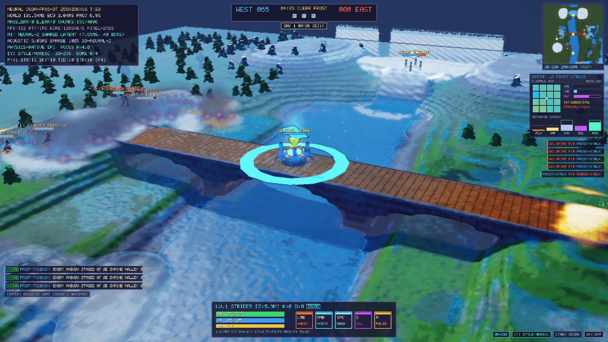

---

## Architecture Overview

1. **Authoritative 3D Volumetric Neural World (`256×256×4` voxels, 10 Hz):**
   - `crates/field-core`: Exact integer-conserving 3D physics kernel (`VolumeField` with vertical gravity `L2→L1→L0`, buoyancy `L1→L2→L3`, convective heat conduction, plunging waterfalls, overhanging Skybridges, and dynamic weather). Strictly guarantees **`mass_error == 0`** and **`energy_error == 0`** behind a projection firewall.
   - `ml/gpu_infer_daemon.py`: Batched FP16 **CUDA Graph** daemon on NVIDIA GB10 (`WorldModel` `[4, 18, 256, 256]` in `18.5 ms` + `EcosystemModel` `[1, 32, 256, 256]` in `2.0 ms`).
2. **Shared-Latent Neural Players / Bots (`BotPolicyNet`, `152K` params):**
   - Instead of re-encoding serialized world packets, `BotPolicyNet` (`ml/bot_policy.py`) samples **zero-copy directly from `WorldModel`'s cached `[4, 48, 256, 256]` VRAM latent trunk (`Z_world`) and `EcosystemModel`'s `[1, 32, 256, 256]` trunk (`Z_eco`)** via `F.grid_sample` (`16×16` ego-crop), fused with 4-head Multi-Head Cross-Attention over `12` nearby entity/shrine/relic tokens (`op=4 OP_BOT_POLICY`).
   - A `1×1` version-pinning latent adapter (`80→32`) isolates policies from `WorldModel` retraining.
   - Live hot-toggleable against scripted bots in real time via the **`N`** key.
3. **Multiplayer QUIC Server (`crates/frostmarsh-server`, `crates/frostmarsh-proto`):**
   - Streams 10 Hz LZ4-compressed `16×16` compositional `A+` voxel chunks (with automatic uni-stream fallback over 1,280 B Tailscale/WAN MTUs) and 30 Hz 3D entity/combat/shrine/telemetry snapshots.
   - 3 playable classes (**Frost Warden**, **Pyro Alchemist**, **Marsh Ranger**), mana/stamina/XP/levels, elemental status effects (`BURN`, `CHILL`, `WET`, `OIL`, `SHIELD`, `HASTE`), 3 capturable Elemental Shrines, Golden Relic, and 6v6 team combat.
4. **Unified `wgpu` Hybrid Client (`crates/frostmarsh-unified-client`):**
   - `O(N)` 3-axis separable smooth normals over authoritative 3D voxel terrain (`L1` surface + `L2` basalt plateaus / Sky-Arch / Timber Skybridge / animated 3D waterfalls + `L3` atmospheric plumes).
   - Parametric CSG/SDF greedy-meshed baked-AO 3D heroes & shrines + **Hard-Z GPU-instanced SDF foliage surfels** (`~411K` surfels, zero sorting) + **depth-tested Soft Volumetric 3D Gaussian Splats** (`volumetric_splat.wgsl`) for fire/steam/smoke/plumes.
   - 9-step Cool-Indigo/Warm-Cream 2× supersampled pixel-art resolve (`T`-key toggles Pixel-2xSS ↔ Clean 3D) + native-resolution GPU 2D Action-MMO HUD (`hud_pass.wgsl`).
5. **Rendering Research Tracks (`ml/tiers/`, `crates/neural-client`):**
   - **Tier 1:** `512×512` Painterly GAN + WorldTex (`ml/tiers/tier1_painterly.py`)
   - **Tier 2:** Free-Camera 3D Neural Deferred G-Buffer (`ml/tiers/tier2_deferred_3d.py`)
   - **Tier 3 & 3-Hybrid:** Custom Triton differentiable EWA 3D Gaussian Splatting (`ml/tiers/tier3_3dgs.py`) upgraded with Hard-Z SDF Surfels + Soft Volumetric 3DGS (`ml/tiers/tier3_hybrid_surfels.py`)
   - **Tier 4:** Few-Step Real-Time Multi-Style Client Diffusion (`ml/tiers/tier4_diffusion.py`)
   - **Thin Neural Client + SpacetimeDB POC:** `crates/neural-client`, `crates/world-worker`, `spacetimedb/`

---

## Verified Benchmarks

### Shared-Latent Neural Bots (`BotPolicyNet` Ablation on Unseen Held-Out `256×256×4` Worlds)

| Metric | Shared-Latent (`+Z_world +Z_eco`) | Blind Ablation (Ledger-Only) | Delta |
|---|---:|---:|---:|
| **Physics-Combo Element Acc** | **92.97%** | 42.68% | **+50.29 pp** |
| **Wildfire Evasion Cosine** | **+0.7473** | −0.1239 | **+0.8712** |
| **Overall Element Selection Acc** | **95.63%** | 74.05% | **+21.58 pp** |
| **Ability Selection Acc** | **97.84%** | 96.22% | **+1.62 pp** |
| **Move / Aim Direction Cosine** | **0.9278 / 0.9724** | 0.8788 / 0.9721 | **+0.0490 / +0.0003** |

- **NVIDIA GB10 Batched GPU Latency (Zero-Copy VRAM):** `12` bots = **`0.659 ms`** (`54.9 µs/bot`) · `64` bots = **`0.700 ms`** (`10.9 µs/bot`) · `256` bots = **`1.491 ms`** (`5.8 µs/bot`).
- **GPU Self-Play RL (`BotPolicyNet-RL`, `ml/train_bot_rl.py` + `models/BOT_RL_TOURNAMENT.json`):** Warm-started from BC and trained across `32` parallel `Z_world` arenas (`384` concurrent bots on GB10). In a 24-match held-out `256×256×4` tournament, `BotPolicyNet-RL` beats **`BotPolicyNet-BC` `95.8%` (`23W–1L`, `51.8` vs. `25.4` physics combos/match, `423.0` vs. `244.5` score)** and **`Blind Ledger-Only` `100.0%` (`24W–0L`)**.
- **Sparse Active-Tile `WorldModel` v2 (`ml/sparse_world_bench.py` + `models/SPARSE_WORLD_BENCH.json`):** Shrinking-halo (`halo=6`, exact FP32 `max_abs_diff = 0.0`) sparse tile batching accelerates `256×256×4` from `11.77 ms` → **`2.90 ms` (`4.06×`)** at `20%` activity (`4.60 ms` / `2.56×` at `30%`) and scales **`512×512×4` (`1,048,576` voxels)** from `52.43 ms` → **`17.22 ms` (`3.05×`)**.
- **Physical 3D Acoustics, Emergent Neural Speech & Viewer Interpreter (`ml/acoustic_comm_poc.py` + [ACOUSTIC_COMM_REPORT.md](models/ACOUSTIC_COMM_REPORT.md)):**
  - `AcousticField3D` runs `256×256×4` 10-step 3D wave/occlusion conv in **`0.144 ms`** (FP16) with `-12 dB/wall` basalt occlusion and `85 dB` waterfall / `77 dB` wildfire noise floors.
  - Emergent unsupervised neural speech (`K=16` Gumbel-Softmax, zero symbol labels) lifts held-out coordination from `6.2%` (Silent) → **`61.3%`** (`91.2%` at High SNR) with `91.4%` symbol purity (`16/16` active), while learned adaptive volume cuts enemy eavesdropping by **`-31.5 pp`**.
  - A `24.8K`-param Viewer Interpreter decodes neural speech into SNR-degraded text at **`98.5%`** High-SNR accuracy (`0.035 ms`), and a `63.3K`-param `g_i` Goal Injector redirects frozen `BotPolicyNet` on **unseen human paraphrases** at **`96.8%` compliance**.
- **Live 1,048,576-Voxel (`512×512×4`) Sparse Neural World + Live Acoustics (Iteration 3):**
  - `SparseWorldRunner` (`ml/sparse_world_runner.py`) with 128-tile bucketing & shrinking-halo (`halo=6`, FP32 `max_abs_diff = 0.0`) runs live **`512×512×4` (`1M` voxels)** on Spark GB10 in **`11.20 ms`** (`SPARSE 8%`, **`4.74×`** faster than `53.12 ms` dense!) with `mass_err = 0`, `energy_err = 0`, and **`100–122 KB/s`** QUIC wire traffic.
  - `LiveAcousticEngine` (`ml/live_acoustics.py`, `acoustic_comm_live.pt`, `1.18 ms` @ `256²×4` / `1.49 ms` @ `512²×4`) runs live via `op=6` (`OP_ACOUSTIC_STEP`), streaming 3D-projected **SNR-tagged speech bubbles** (`+28 dB` clear replies vs. `-10 dB` waterfall/wall-muffled) and executing live human **`Enter`-key acoustic chat commands** (`SHOUT 1.0` / `WHISPER 0.25`) via `g_i` steering overrides.
- **Iteration 4 — Conservation-Distilled `WorldModel` v3 & Dual-Scale `BotPolicyNetV2-RL`:**
  - `WorldModel` v3 (`ml/train_world_v3.py`, `world_model_v3.pt`, [WORLD_V3_METRICS.json](models/WORLD_V3_METRICS.json)): Cut held-out projection firewall active rate by **`-76.6%`** (`22.27%` → **`5.21%`**) while beating v1 raw MAE by **`-23.1%`** and keeping `0.9906` `Z_world` cosine compatibility with `SparseWorldRunner` (`FP32 diff = 0.0`).
  - Dual-Scale `BotPolicyNetV2-RL` (`ml/bot_policy_v2.py`, `ml/train_bot_rl_v2.py`, `bot_policy_v2_rl.pt`, [BOT_RL_V2_TOURNAMENT.json](models/BOT_RL_V2_TOURNAMENT.json), `215K` params, `0.71 ms` / 12 bots): Fuses fine `14`-cell + coarse `60`-cell `Z_world` ego-crops. In 24-match held-out `256×256×4` tournaments, it beats **Scripted Teacher `87.5%` (`21W–3L`, `73.7` vs. `47.0` combos/match)**, **RL v1 `95.8%` (`23W–1L`, `3×` less wildfire burn)**, **BC `100.0%` (`24W–0L`)**, and **Blind `100.0%` (`24W–0L`)**.
  - **Procedural 3D Spatial Audio (`cpal` `src/audio.rs`) + 5-Min Match Loop & `Tab` Scoreboard:** Pure-Rust lock-free stereo DSP soundscape (panned waterfall/wildfire/weather ambience + **SNR-filtered neural-voice synth chirps**, `U`-key mute), `5:00` / `500`-pt match loop with MVP Victory banner, and **zero compiler warnings** across the entire Rust workspace.
- **Iteration 5 — Zero-Hardcoded-Rules Emergent Physical Actuators & Pure-Physics Coupling (Trained on Colab `A100-SXM4-40GB`):**
  - `ActuatorPolicyNet` (`ml/actuator_policy.py`, `ml/train_actuator_rl.py`, `actuator_policy_rl.pt`, [ACTUATOR_EMERGENCE_METRICS.json](models/ACTUATOR_EMERGENCE_METRICS.json), `214.6K` params): Replaces fixed named spells and `if was_oiled` rules with **`10` continuous conservation-bounded physical actuator channels** (`±thermal_flux`, `water/oil/smoke` matter emission, continuous `focus_radius`, kinetic `impulse`).
  - Trained purely from random weights via sparse-goal PPO across **`64` parallel arenas (`768` bots, `3.69M` bot-steps at `10,799` steps/s on A100)** with zero imitation teacher: autonomously discovered **Oil→Ignition detonations (`15.5`/match)**, **Flash-Boil Steam Bursts (`17.5`/match)**, **Cryo-Bridge Crossings (`13.1`/match)**, **Smokescreen Cover (`7.9`/match)**, and bimodal `focus_radius` specialization (wide `3.5–7.0` cryo fields vs. tight `1.8–3.5` thermal beams). Beats Random Actuators **`100.0%` (`24W–0L`)** and Thermal-Only (no matter) **`62.5%` (`15W–9L`, `+88.6%` pressure-wave damage)**.
  - **Live Physics-Native Engine (`P`-key hot-toggle `PHYSICS-NATIVE` ↔ `CLASSIC`):** `VolumeField::apply_physical_actuator` + `sample_entity_physics` (`8/8` exact `mass_err=0, energy_err=0` tests) drive thermal stress, combustion `ΔT` / flash-boil `Δsteam` blasts + knockback, ice/oil/water friction, and `L2` skybridge collapse directly from voxels (`op=7` live at `2.28 ms` / 12 bots alongside `8.69 ms` sparse `512×512×4` world!).
- **Iteration 6 — Pure Continuous Actuators Beat Legacy Named Spells `91.67%` + True 3D Cross-Layer `WorldModel3D` v4 + Sparse `EcosystemModel` & 3D Beam VFX:**
  - `ActuatorPolicyNet` v2 (`ml/train_actuator_rl_v2.py`, `actuator_policy_v2_rl.pt`, [ACTUATOR_V2_TOURNAMENT.json](models/ACTUATOR_V2_TOURNAMENT.json), trained on Colab `RTX PRO 6000 Blackwell` via `768`-bot League Self-Play, **zero hardcoded spells, zero imitation teacher**):
    - **vs. Legacy Named-Spell Scripted:** **`91.67%` WR (`22W–2L`, `371.0` vs. `240.5` score, `84.0` Oil→Ignition & `107.9` Flash-Boil Steam bursts/match, `2.45×` pressure-wave damage!)**
    - **vs. Actuator v1 (Iter 5A):** **`100.0%` (`24W–0L`)** · **vs. Thermal-Only:** **`95.83%` (`23W–1L`)** · **vs. Random:** **`100.0%` (`24W–0L`)**.
  - **True 3D Cross-Layer `WorldModel3D` v4** (`ml/world_model_3d.py`, `ml/train_world_3d_v4.py`, `world_model_3d_v4.pt`, [WORLD_3D_V4_METRICS.json](models/WORLD_3D_V4_METRICS.json), `123.8K` params): Adds `1×1×3` cross-layer mixing + vertical interface transport head (`flux_z_water/oil/steam/smoke`, `heat_z`), jumping **composite 3D vertical R² from `-0.031` (2D v3) → `+0.813`** (`0.922` active waterfall gravity R², `0.758` buoyancy R², `0.897` vertical heat R²) while keeping `proj_active_pct = 5.25%` (`< 6%`) and `0.999991` `Z_world` cosine parity.
  - **`SparseEcoRunner` (`ml/sparse_eco_runner.py`, FP32 `max_abs_diff = 2.09e-7`) + Live 3D Volumetric Actuator Beam VFX (`ActuatorPulseSnap`):** Cut live `512×512` `ECO` latency from `11.51 ms` → **`7.50 ms`** (`-35%`) and renders continuous heat beams, cryo cones, matter streams, and kinetic shockwave rings through `volumetric_splat.wgsl` + dynamic point lights.
- **Iteration 7 — Live `WorldModel3D` v4 (`op=8`), Continuous `Δt` Time Dilation (`WorldModelDT`), System-2 `Z_world → Qwen2.5-1.5B` Dialogue & Unified Client Overhaul:**
  - **Live 3D Neural Vertical Physics (`op=8`, `SparseWorld3DRunner`, `apply_neural_3d_vertical_fluxes`):** Replaced hardcoded Rust vertical exchange on Spark GB10 with live `WorldModel3D` v4 predicting cross-layer gravity, buoyancy, and convective heat fluxes behind exact integer antisymmetric conservation (`9/9` `field-core` tests, `mass_err = 0`, `energy_err = 0` even under adversarial `NaN`/`±Inf` proposals; `15.77 ms` @ `512×512×4`, `SPARSE 6%`, `3D-NEURAL-Z`).
  - **Physics-Coupled Diurnal World Time (`K`-Key Time-Warp `1×/4×/16×/0.25×`):** Solar cycle physically freezes rivers at midnight and thaws/dries timber at midday (`apply_solar_cycle_3d`, exact `faucet_energy` conservation) paired with full sunrise/noon/dusk/moonlit-night lighting and HUD world clock (`DAY N HH:MM [K]1X`).
  - **`WorldModelDT` Continuous `Δt` Time-Dilation & Emergent Destructible Structures** (`ml/world_model_dt.py`, `world_model_dt.pt`, [WORLD_DT_STRUCTURES_METRICS.json](models/WORLD_DT_STRUCTURES_METRICS.json), `132.3K` params, Colab `L4`): Beats naive linear `Δt·v4` at `4.0×` (`Horiz R² = 0.7634` vs `0.3825`, `Rxn R² = +0.6663` vs `-0.4964`); **`2.79×`** adaptive multi-rate temporal-sparsity speedup at `512×512×4`; **`0.15×` Stasis Domes freeze wildfires `88.7%` and plunging waterfalls `86.6%`** (`3.0×` zones accelerate burn `2.34×`, drift `5.1e-10`); and `struct_head` (`R² = 0.800`) drives **L2 timber skybridge burn/collapse (`t=7`)**, **cryo ice rampart construction (`t=9`, `99.4%` integrity)**, and **thermal dam breach river redirection (`12.7k` mass surge)**.
  - **System-2 `Z_world → Qwen2.5-1.5B-Instruct` Physics-Grounded Dialogue** (`ml/system2_slm.py`, [SYSTEM2_SLM_METRICS.json](models/SYSTEM2_SLM_METRICS.json), [SYSTEM2_SLM_REPORT.md](models/SYSTEM2_SLM_REPORT.md)): Runs on Spark GB10 (`bf16`, `3.44 GB` peak VRAM) at **`56.86 ms` p50 TTFT**, `44.45 tok/s`, **`0.78 µs`** non-blocking submit (zero 30 Hz stall), **`100%` valid structured `g_i` actuator plans (`38/38`)**, and **`100%` low-SNR acoustic awareness** (waterfall `-6.3 dB`, L0 cavern `-14.8 dB`, basalt wall `-1.4 dB`).
  - **Unified Client Playability & Visual Overhaul:** Fixed exact 360° cursor facing (`(-aim_x).atan2(aim_y)` + 0 ms 3D `AimReticle`), added server-matched `ack_input_seq` replay prediction + 60 Hz edge-triggered inputs + 0 ms predicted actuator beams, smoothed terrain heightfields (`3×3` zero-spike pass), re-proportioned towering Nordic pines (`3–4×` hero height) & monumental `y=8.35` L2 Sky-Arches, and doubled Metal FPS to **`119.4–130.5 FPS` @ 1080p / `96.7–119.0 FPS` @ 4K**.
- **Iteration 8 — True Isotropic 3D `Z=16` Neural Material Field (`NeuralField3DEncoder` + Client-Swappable `NeuralMaterialHead`), `384 FPS` Surface-Nets vs. Raymarch Head-to-Head, & Live `WorldModelDT` + `Qwen2.5-1.5B`:**
  - **True 3D `Z=16` (`1m×1m×1m`) Neural Field & `NeuralMaterialHead(Z_world)`** (`ml/neural_field_3d.py`, `ml/train_neural_field_3d.py`, `neural_field_3d_z16.pt`, [NEURAL_FIELD_3D_METRICS.json](models/NEURAL_FIELD_3D_METRICS.json), Colab `RTX PRO 6000 Blackwell`): Cleanly splits server **`NeuralField3DEncoder` (`46.5K` params, `Z_world_3d`)** from a swappable **`12.4K`-param (`50 KB`) `NeuralMaterialHead`** outputting two direct-to-GPU `RGBA8` 3D textures (`density_mat` + `albedo_thermal`). Held-out unseen `256×256×16` R²: **`0.9995` `density_mat`**, **`0.9978` `albedo_thermal`**, **`0.9987` 3D surface normal cosine**, exact `0.0` sparse-vs-dense FP32 parity, **`0.624 ms`** (`256×256×16` @ 5% active) / **`1.718 ms` (`13.1×` speedup)** for **`4.19M` voxels (`512×512×16`)**, and **`0` penetrations / `0` snags** across `56,320` continuous `∇solid_density` 3D capsule steps!
  - **Head-to-Head Direct-3D-Texture Metal GPU Benchmark (`crates/frostmarsh-3d-sandbox`, [RENDER_3D_HEADTOHEAD_METRICS.json](models/RENDER_3D_HEADTOHEAD_METRICS.json), [NEURAL_E2E_Z16_METAL_METRICS.json](models/NEURAL_E2E_Z16_METAL_METRICS.json)):** Tested **both** direct 3D-texture shaders on vaulted caves, 3-span arched bridges, waterfalls, and Track 8A's live neural volume (`z16_demo_volume.bin`, zero hardcoded terrain rules):
    - **Smooth Surface-Nets + 3D-Tex Shading + Raymarched Vol Overlay (Winner, `2.8–3.2×` faster, `1.33/255` MAE parity):** **`339–384 FPS` @ 1080p** (`2.60–2.95 ms`), **`100–115 FPS` @ 4K** (`8.70–9.99 ms`), **`365–652 FPS` in vaulted caves**, and **`0.031–0.033 ms` (`33 µs`)** per dirty `16×16×16` brick!
    - **Sparse `8×8×8` Brick DDA Raymarch:** `105–139 FPS` @ 1080p (`7.19–9.51 ms`), `31.5–39.6 FPS` @ 4K.
  - **Live on Spark GB10 (`512×512×4 = 1,048,576` voxels, 6 Concurrent Neural Models):** Wired `WorldModelDT` (`op=9`, **`J`-key** `0.15×` Stasis / `3.0×` Haste Time-Dilation Domes), non-blocking **`Qwen/Qwen2.5-1.5B-Instruct` (`SLM:ON`)** live `Enter`-key acoustic chat, and **1:1 continuous bilinear solid-density gradient capsule wall-sliding collisions** (smoothly weaving between towering pine trunks with `0` warnings and `mass_err = 0`, `energy_err = 0`).
- **Iteration 9 — Client-Side WGSL `NeuralMaterialHead(Z_world)` + Swappable Styles + True 3D `Z=16` Server (`Brick3D`) + WebGPU/WASM Browser Client:**
  - **Client-Side WGSL Neural Decoder & Swappable Client Styles (`ml/export_client_material_wgsl.py`, `crates/frostmarsh-3d-sandbox`, [STYLIZED_3D_Z16_METRICS.json](models/STYLIZED_3D_Z16_METRICS.json)):** Server exports ONLY compressed `Z_world_3d` latent bricks (`z16_latent_bricks.bin`, zero baked RGB). Client GPU caches **`4 KB`** of active style weights in workgroup SRAM (`neural_material_decode.wgsl`) and decodes all **`1,048,576` voxels in `0.935 ms`** (`12.2 µs` / dirty `16³` brick, bit-exact `0` diff vs CPU, `R² = 0.994–0.997`). Layers Frostmarsh triplanar masonry/terrain detail, Hard-Z sculpted pine surfels (`22.4K`), and 2×SS ink outlines on top of true 3D `Z=16` caves & arched bridges at **`238 FPS` @ 1080p `PIXEL-2×SS`** (`331 FPS` Clean-3D, `101 FPS` @ 4K), with **`Y`-key** live `0.92 ms` client style swapping (`NORDIC` ↔ `VOLCANIC EMBER` ↔ `ARCANE THERMAL`) on the same `Z_world_3d`!
  - **True 3D `Z=16` Authoritative Engine (`field-core` + `frostmarsh-proto` + `frostmarsh-server`):** Added `VolumeField::init_shattered_reach_z16()` (`11/11` `field-core` conservation & 3D cave/bridge capsule tests passing, `mass_err = 0`, `energy_err = 0`), LZ4 `ServerDatagram::VolumetricBrick3D` streaming, and `--layers 16` server (`7.5 ms/tick` @ `128×128×16`) while keeping `--layers 4` 100% compatible.
  - **WebGPU/WASM Browser Client (`crates/frostmarsh-web-client` → `web/pkg/`):** Compiled true 3D `Z=16` Smooth Surface-Nets + Volumetric Overlay + 3D Hero Knights + `T`-key `Pixel-2×SS` ↔ `Clean-3D` + `C`-key `∇solid_density` capsule walk to `wasm32-unknown-unknown` (`993 KB` gzipped, `0` warnings under `-D warnings`, `python3 web/serve.py` → `http://127.0.0.1:8080`).
- **Iteration 10 — The Grand Unification (Live True 3D `256×256×16 = 1,048,576` Isotropic Voxel Multiplayer Over QUIC):**
  - **Live `VolumetricBrick3D` + Smooth Surface-Nets + `Y`-Key Client Styles inside `frostmarsh-unified-client`:** Auto-detects `--layers 16` servers, receives LZ4-compressed `16×16×16` 3D bricks (`868.5 KB` full sync for `256×256×16` = `1.05M` voxels, `170,708` Surface-Nets triangles built in `15.96 ms`), renders true 3D vaulted caves, 3-span arched stone/timber bridges with triplanar masonry, sculpted Hard-Z pine surfels, raymarched volumetric water/fire/smoke, exact `∇solid_density` 3D capsule prediction, `T`-key `PIXEL-2×SS` ↔ `CLEAN-3D`, and **`Y`-key live client style swap (`NORDIC` ↔ `VOLCANIC EMBER` ↔ `ARCANE THERMAL`)** while keeping `--layers 4` 100% compatible.
  - **Live `L=16` 6-Model Neural Stack on Spark GB10 (`cuda-fp16-dt`, `mass_err = 0`, `energy_err = 0`):** Generalized `SparseWorld3DRunner` & `SparseWorldDTRunner` to arbitrary `L` (`3.45e-8` `L=16` sparse-vs-dense parity, `5×` lower peak VRAM) with 4-band vertical pooling for `BotPolicyNetV2`, `ActuatorPolicyNet` v2 (`op=7`), `LiveAcousticEngine` (`op=6`), and `Qwen2.5-1.5B-Instruct` (`SLM:ON`).
  - **Live Apple M4 Pro Metal Performance (`256×256×16` True 3D Over QUIC):** **`149.4 FPS`** @ 1080p `PIXEL-2×SS` (`6.69 ms`) · **`165.4 FPS`** @ 1080p `CLEAN-3D` (`6.05 ms`) · **`155.1 FPS`** @ 4K `PIXEL-2×SS` (`6.45 ms`).
- **Iteration 11 — Conservation-Distilled `WorldModel3D-v5`, 5-Biome True 3D `Z=16..32` (`2.1M` Voxels), Closed 3D Hydrologic Weather, Cave Cutaway & Schroeder Cave Reverb:**
  - **`WorldModel3D-v5` (`ml/world_model_3d_v5.py`, `ml/train_world_3d_v5.py`, `world_model_3d_v5.pt`, [WORLD_3D_V5_METRICS.json](models/WORLD_3D_V5_METRICS.json), `158.4K` params, A100-SXM4-40GB):** Factorized `(1,3,3)+(3,1,1)` + isotropic `3×3×3` bottleneck Conv3d with continuous log-`Δt` FiLM and `16×16×8` true 3D sparse brick acceleration (`SparseWorld3DV5Runner`, FP32 dense-vs-sparse parity **`1.16e-10`**, `Δt=0` stasis **`0.0`**). Cut held-out conservation firewall activity **`7.0×`** (`40.93%` → **`5.85%`** at `Z=16`, **`6.60%`** at `Z=32`, and **`6.65–6.92%` LIVE on Spark GB10**!), achieving **`0.9801`** gravity water R², **`0.9695`** steam buoyancy R², **`0.9814`** smoke buoyancy R², and **`0.9860`** closed 3D cloud precipitation R². Scales `16×16×8` sparse bricks (10% active, A100 FP16) to **`18.3 ms`** (`1.05M` vox, `54.6 Hz`), **`31.9 ms`** (`2.10M` vox, `31.3 Hz`), and **`53.2 ms`** (`4.19M` vox, `2.1×` faster than dense).
  - **5-Biome True 3D `Z=16..32` (`2,097,152` Voxels) Engine (`F7` Live Biome Cycle):** Added **Nordic Viaduct**, **Volcanic Caldera**, **Sinkhole Caverns** (2-level stacked subterranean galleries at `Z=32`), **Glacier Gorge**, and **Geothermal Basin**, plus closed high-altitude steam condensation/rain/snowfall and conservative 3D burning-bridge / melting-ice-arch collapse (`mass_err = 0`, `energy_err = 0`). Verified LIVE on Spark GB10 → Apple M4 Pro Metal at `256×256×32` (`2.1M` voxels): **Volcanic Caldera** (`104.8 FPS` @ 1080p / `105.1 FPS` @ 4K, `226K` tris), **Glacier Gorge** (`153.6 FPS` @ 1080p / `159.9 FPS` @ 4K, `569.5 KB` LZ4), and **Sinkhole Caverns** (`110.7 FPS` @ 1080p / `110.6 FPS` @ 4K, `313.6K` tris).
  - **Smart 3D Cave Ceiling Cutaway, Pure-Rust Schroeder Cave Reverb & Live `4 KB` SRAM WGSL 4-Style Compute:** Added 4×4 Bayer screen-door roof cutaway + glowing cross-section rim when walking under cave roofs/bridges, pure-Rust zero-alloc 4-comb + 2-allpass `SchroederCaveReverb` driven by `3×3` overhead enclosure probes (`CAVE ECHO %`), and live `neural_style_z16.wgsl` compute shader (`NORDIC` ↔ `VOLCANIC EMBER` ↔ `ARCANE THERMAL` ↔ `EMERALD CAVERN`).
- **Iteration 12 — Evolving Persistent 3D World, 40–64 Simultaneous Players, 4 Physical Archetypes (Walk/Fly/Swim/Climb), Squads vs. Solos, True-3D `ActuatorPolicyNetV3` & Live WebSocket WebGPU Browser Client:**
  - **Evolving Persistent 3D World (`VolumeField::step_world_evolution_3d`, `F9` Speed `1×/4×/12×`, `13/13` `field-core` tests, `mass_err = 0`, `energy_err = 0`):** Hot magma/oil quenched by water/rain solidifies permanent **`SP_ROCK` basalt landforms** (`56,938` events over 130 live ticks); sunlit ash + moisture regrows **`SP_PLANT → SP_WOOD` living forests** (`238,566` events); cold moisture builds **glacial ice caps** (`102,078`); fast rivers carve **hydraulic soil erosion** (`202,400`) — all with exact integer mass & energy conservation.
  - **4 Physically Distinct Player Archetypes + Squads vs. Solos + 40–64 Player Scale:**
    - **`Strider` (`class 0`, Squad Anchor):** Armored heavy walker (`175 HP`, `0.40×` knockback, tower shield + rally halo).
    - **`Skywing` (`class 1`, True 3D Flyer & Thermal Glider):** Articulated flapping/banking elemental wings (primary + shadow pass), free 3D flight up to `Z-2m`, and **passive Thermal Updraft lift** over fires/magma/steam!
    - **`Tidekin` (`class 2`, Amphibious Swimmer/Diver):** Bioluminescent dorsal fin + aqua wake, **`2.0×` hydrodynamic water speed**, zero chill drag, 3D submerged diving & breach-leap!
    - **`Emberstalker` (`class 3`, Solo Cavern Climber, `F8` select):** Dark hooded twin-blade raider, **`3.5m` vertical cliff/cave wall-climbing**, **Smoke Veil** stealth/speed boost, autonomous solo flanking vs. coordinated 3–4 player squads executing cross-class elemental combos!
  - **Live 7-Model Stack + 40 Simultaneous Players on Spark GB10 → Metal:** Running `WorldModel3D-v5` (`proj_active_pct = 6.92%`) + True-3D `ActuatorPolicyNetV3` (`ml/actuator_policy_v3.py`, `294.3K` params, zero-copy 5D trilinear `Z_world_3d` crops, `op=10` & transparent `op=7` upgrade, `100.0%` WR vs Flat-2D Ablation & `95.8%` vs Random-3D in [ACTUATOR_V3_TOURNAMENT.json](models/ACTUATOR_V3_TOURNAMENT.json)) + `Qwen2.5-1.5B` + `SparseEcoRunner` + `LiveAcousticEngine` + `BotPolicyNetV2` with **40 live heterogeneous bots in `7.65 ms`** at **`163.3 FPS` @ 1080p Pixel-2×SS / `176.3 FPS` Clean-3D / `165.0 FPS` @ 4K Pixel-2×SS** (`mass_error = 0`, `energy_error = 0`).
  - **Live Zero-Dependency RFC 6455 WebSocket Bridge (`--ws-bind 0.0.0.0:4434`) & Upgraded WebGPU/WASM Browser Client (`web/`):** Pure-Tokio `ws_bridge.rs` (`4/4` tests) streams real `0x01` `Z=16..32` volumetric bricks + `15 Hz` `0x02` live entity JSON directly to `crates/frostmarsh-web-client` (`5/5` tests, `0` warnings under `-D warnings`, 4-style `Y`-key shaders, `C`-key cave cutaway, `Z=16/24/32` depth toggle).

### Unified Client Performance (Apple M4 Pro Metal, Live over QUIC)

| World Scale & Mode | Render Mode | Resolution | p50 Frame Time | FPS |
|---|---|---|---:|---:|
| **`256×256×16` (40P 4-Archetype Evolving)** | **Surface-Nets + 4KB SRAM WGSL + Pixel-2xSS** | **1920×1080** | **`6.13 ms`** | **163.3 FPS** |
| **`256×256×16` (40P 4-Archetype Evolving)** | **Surface-Nets + 4KB SRAM WGSL + Clean 3D** | **1920×1080** | **`5.67 ms`** | **176.3 FPS** |
| **`256×256×16` (40P 4-Archetype Evolving)** | **Surface-Nets + 4KB SRAM WGSL + Pixel-2xSS** | **3840×2160 (4K)** | **`6.06 ms`** | **165.0 FPS** |
| **`256×256×32` (2.10M vox Glacier Gorge)** | **Surface-Nets + 4KB SRAM WGSL + Pixel-2xSS** | **3840×2160 (4K)** | **`6.25 ms`** | **159.9 FPS** |
| **`256×256×32` (2.10M vox Sinkhole Caverns)** | **Surface-Nets (`313.6K` tris) + Pixel-2xSS** | **1920×1080** | **`9.03 ms`** | **110.7 FPS** |
| **`256×256×32` (2.10M vox Volcanic Caldera)** | **Surface-Nets (`226.2K` tris) + Pixel-2xSS** | **3840×2160 (4K)** | **`9.52 ms`** | **105.1 FPS** |
| **`512×512×4` (1.05M vox)** | **Pixel-2xSS + Vol3DGS + Brain/Speech HUD** | **1920×1080** | **`8.37 ms`** | **119.4 FPS** |

---

## Visual Showcase

| Live 2.1M-Voxel (`256×256×32`) Volcanic Caldera + Cloud Condensation (`105 FPS` @ 4K) | Live 2.1M-Voxel (`256×256×32`) Sinkhole Caverns (`313K` tris, `111 FPS`) |
|---|---|
| 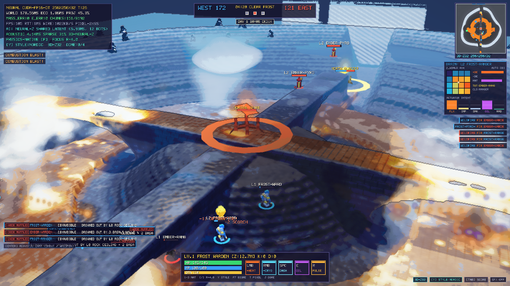 | 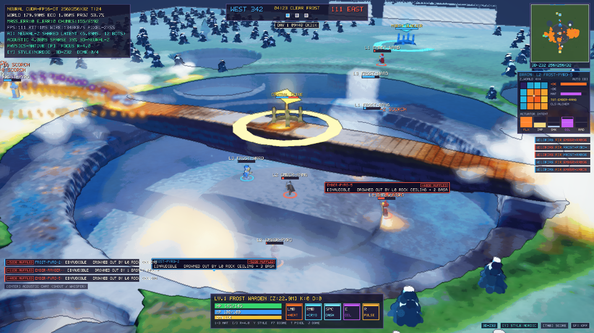 |

| Live 2.1M-Voxel (`256×256×32`) Glacier Gorge (`160 FPS` @ 4K) | Live 40-Player 4-Archetype 4-Style WGSL Orbit (`163 FPS`) |
|---|---|
| 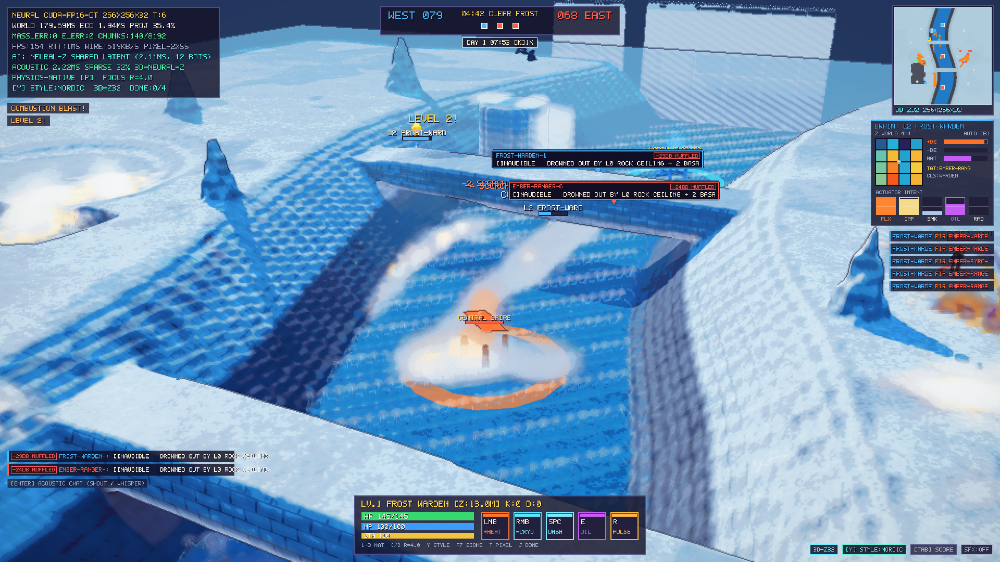 | 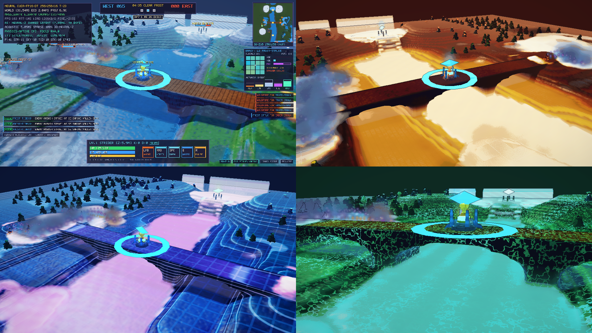 |

| `WorldModel3D-v5` (5 Biomes, `7.0×` Lower Firewall, `4.19M`-Vox Sparse Bricks) | `ActuatorPolicyNetV3` (True 3D `Z=16` 4-Archetype RL & Emergent Tactics) |
|---|---|
| 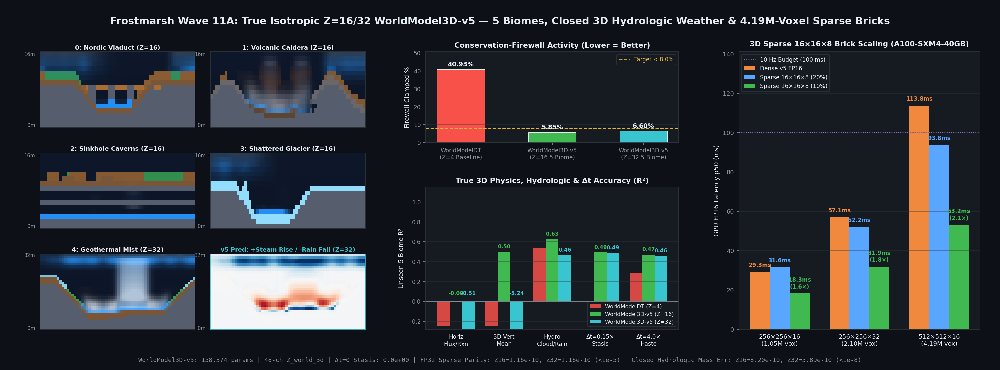 | 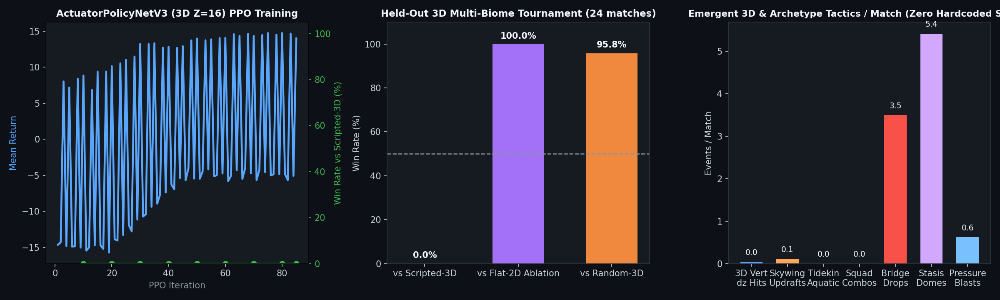 |

| Live True 3D `256×256×16` Multiplayer 4-View Orbit + Live `Y`-Key Client Style Swap | Client-Side WGSL `NeuralMaterialHead(Z_world)`: Stylized True 3D `Z=16` (`0.94 ms` Decode) |
|---|---|
| 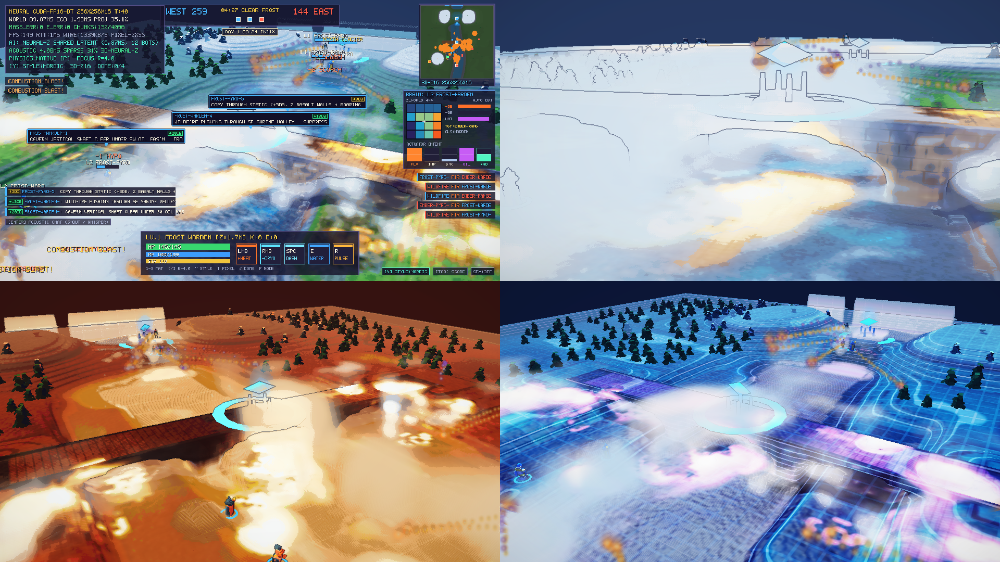 | 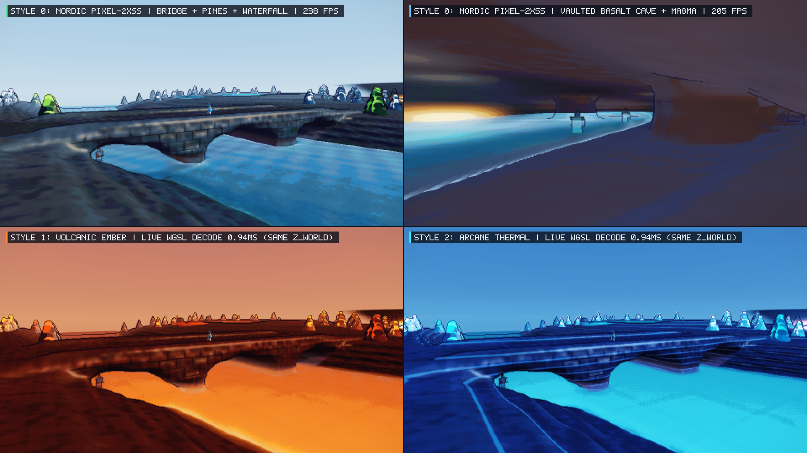 |

| `WorldModelDT` Continuous Δt Time-Dilation & Destructible Structures | True 3D `Z=16` Neural Material Field & `13.1×` Sparse Brick Scaling |
|---|---|
| 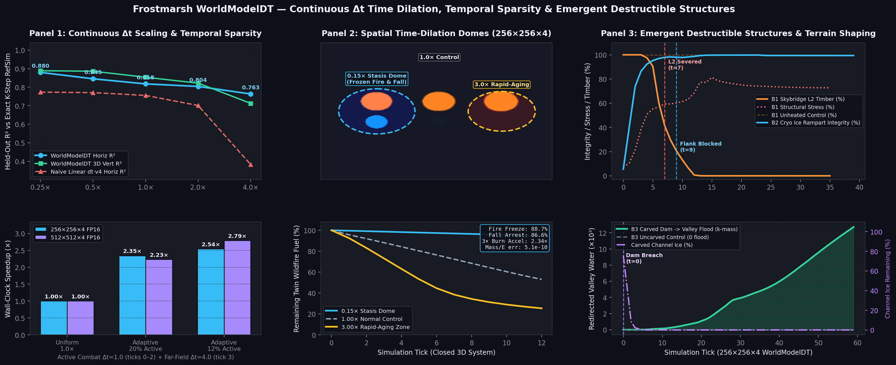 | 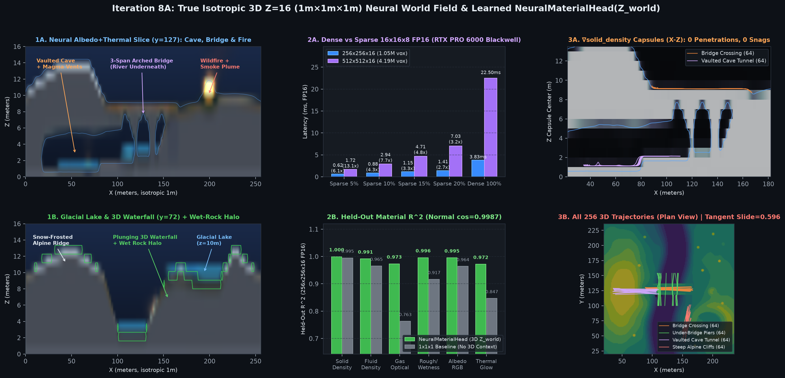 |

| Tier 1 (`512²` Painterly) | Tier 4 (Multi-Style Client Diffusion) |
|---|---|
|  |  |

---

## Quick Start

### 1. Download Pretrained Models from Hugging Face
```bash
./scripts/download_models.sh
```
This pulls all `.pt` and `.onnx` weights from [`carlid/frostmarsh-neural-world`](https://huggingface.co/carlid/frostmarsh-neural-world) into `models/`.

### 2. Start the GPU Inference Daemon (Optional — requires CUDA GPU)
```bash
python3 ml/gpu_infer_daemon.py \
  --world-model models/checkpoints/world_model.pt \
  --eco-model models/checkpoints/ecosystem_model.pt \
  --bot-policy models/checkpoints/bot_policy.pt \
  --bind 127.0.0.1:14440
```

### 3. Start the Authoritative 3D QUIC Server
```bash
# With CUDA GPU daemon (neural world + neural bots):
cargo run --release --no-default-features -p frostmarsh-server -- \
  --bind 0.0.0.0:4433 --backend cuda-rpc --cuda-addr 127.0.0.1:14440 \
  --size 256 --layers 4 --bots 12 --aoi-radius 10

# Or standalone CPU RefSim (no GPU needed):
cargo run --release --no-default-features -p frostmarsh-server -- \
  --bind 0.0.0.0:4433 --backend refsim --size 256 --layers 4 --bots 12
```

### 4. Launch the Unified Hybrid 3D Client
```bash
FROSTMARSH_SERVER=127.0.0.1:4433 ./play_frostmarsh.sh
```

### Live Controls
| Key | Action |
|---|---|
| `WASD` / Arrows | Move across 3D terrain & overhanging Skybridges |
| `Left Click` | Cast elemental bolt (writes directly into the 3D neural world) |
| `Right Click` / `F` | Melee arc cleave |
| `1` / `2` / `3` | Select element: **1: Fire**, **2: Frost**, **3: Oil** |
| `Space` | Dash |
| `E` / `R` | Class signature ability & Ultimate |
| `F1` / `F2` / `F3` / `F8` | Switch physical archetype (**Strider** Walker, **Skywing** Flyer, **Tidekin** Swimmer, **Emberstalker** Solo Climber) |
| **`F7`** | **Cycle Live 3D Biome (`Nordic Viaduct` → `Volcanic Caldera` → `Sinkhole Caverns` → `Glacier Gorge` → `Geothermal Basin`)** |
| **`F9`** | **Cycle Evolving World Speed (`1× → 4× → 12×` basalt forging, forest regrowth, glacial expansion & erosion)** |
| **`P`** | **Live hot-toggle `PHYSICS-NATIVE` continuous actuators ↔ `CLASSIC` named spells** |
| **`K`** | **Cycle Diurnal World Time-Warp (`1× → 4× → 16× → 0.25×` solar freeze/thaw cycle)** |
| **`J` / `Shift+J`** | **Place `0.15×` Stasis Dome / `3.0×` Haste Zone at cursor (`Shift+J` clears domes)** |
| **`Y`** | **Live hot-swap Client WGSL Neural Style (`NORDIC` ↔ `VOLCANIC EMBER` ↔ `ARCANE THERMAL` ↔ `EMERALD CAVERN`)** |
| **`LMB` / `RMB` / `[` `]`** | **In Physics-Native mode: `+ΔE` Heat / `-ΔE` Cryo / Adjust Focus Radius (`2.0..8.0`)** |
| **`Enter` / `Tab`** | **Open live Acoustic Chat (`Tab` toggles SHOUT/WHISPER while typing; hold `Tab` outside chat for 6v6 Scoreboard)** |
| **`U`** | **Mute / unmute procedural 3D spatial audio & SNR-filtered voice synths** |
| **`N`** | **Live hot-toggle Shared-Latent Neural-Z Bots ↔ Scripted Bots** |
| **`B`** | **Cycle Live Neural-Brain Inspector (`4×4` `Z_world` heatmap + intents)** |
| **`V`** / `F6` | **Cycle dynamic weather (`Clear Frost`, `Blizzard`, `Squall`, `Ember Storm`)** |
| **`L`** | **Cycle 3D Volumetric Layer Slice view** |
| **`T`** | **Toggle Pixel-2xSS ↔ Clean 3D rendering** |
| **`M`** | **Hot-toggle Neural World Model ↔ Exact RefSim** |
| `Q` / `Z` / Scroll | Orbit camera & zoom |

---

## Repository Layout

- `crates/field-core/` — Conservation-checked 2D & 3D (`VolumeField`) physics engine & unit tests
- `crates/frostmarsh-proto/` — `A+` voxel codec, LZ4 chunk/datagram framing, multiplayer protocol
- `crates/frostmarsh-server/` — 30 Hz QUIC server, 6v6 classes/combat/shrines, `op=4` neural bot RPC
- `crates/frostmarsh-unified-client/` — `wgpu` hybrid 3D/pixel-art renderer, Hard-Z surfels, Volumetric 3DGS, GPU HUD
- `crates/neural-client/`, `crates/world-worker/`, `spacetimedb/` — Thin ONNX neural client & SpacetimeDB POC
- `ml/` — `WorldModel`, `EcosystemModel`, `BotPolicyNet` (`bot_policy.py`, `train_bot_policy.py`), `gpu_infer_daemon.py`, gate evaluation
- `ml/tiers/` — Tiers 1–4 & Tier 3 Hybrid Surfel+3DGS training & benchmarking scripts
- `models/` — Engineering reports (`BENCHMARK_REPORT.md`, `LATENT_EXPERIMENT.md`, `tiers/*_REPORT.md`), metric JSONs, and visual captures
- `FIELD_CONTRACT.md` — Formal specification of the `A+` conservation & neural world contract
