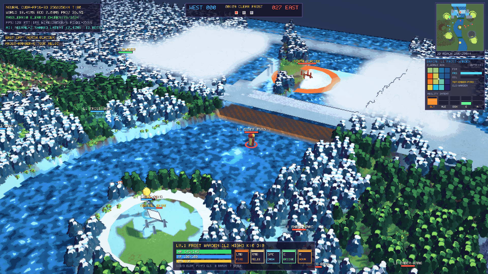
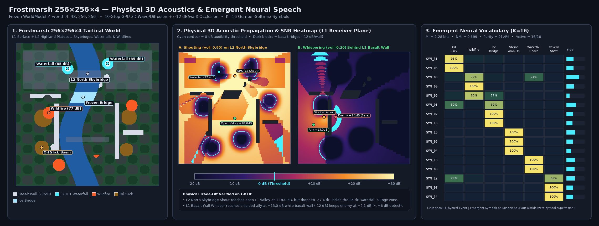
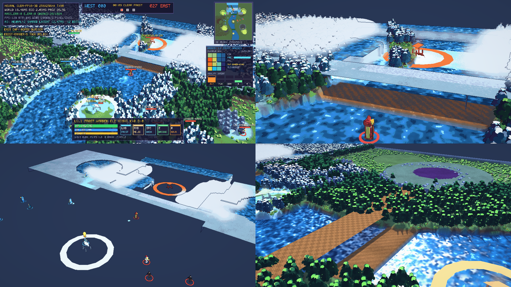
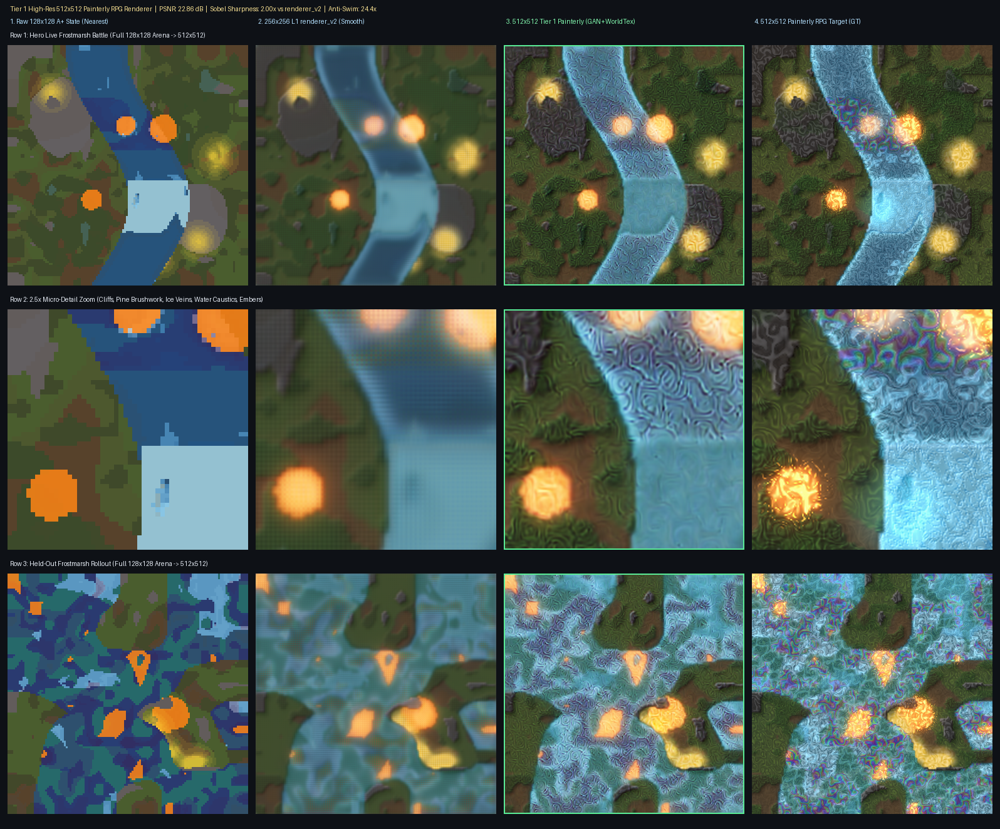
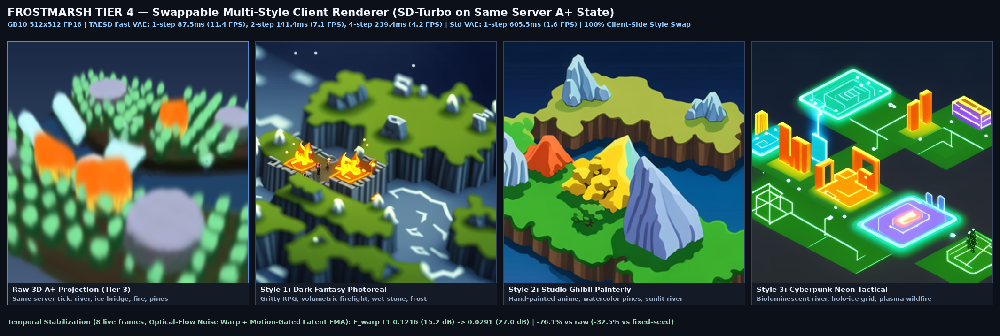

# Frostmarsh — Authoritative 3D Neural World, Shared-Latent Neural Bots & Hybrid GPU Client

**Frostmarsh** is a live multiplayer action-MMO architecture combining a **conservation-guarded 3D volumetric neural world model** (`256×256×4 = 262,144` coupled voxels at 10 Hz), **zero-copy shared-latent neural bots** (`BotPolicyNet` reading directly from `WorldModel` VRAM latents), and a **unified Rust `wgpu` hybrid 3D/pixel-art client** over QUIC — alongside a full 5-track neural rendering research suite (Tiers 1–4 + Approach 4).

> **Model Checkpoints (`.pt` & `.onnx`)** are hosted on Hugging Face Hub: **[`carlid/frostmarsh-neural-world`](https://huggingface.co/carlid/frostmarsh-neural-world)** — pull them into `models/` with `./scripts/download_models.sh`.



---

## Architecture Overview

1. **Authoritative 3D Volumetric Neural World (`256×256×4` voxels, 10 Hz):**
   - `crates/field-core`: Exact integer-conserving 3D physics kernel (`VolumeField` with vertical gravity `L2→L1→L0`, buoyancy `L1→L2→L3`, convective heat conduction, plunging waterfalls, overhanging Skybridges, and dynamic weather). Strictly guarantees **`mass_error == 0`** and **`energy_error == 0`** behind a projection firewall.
   - `ml/gpu_infer_daemon.py`: Batched FP16 **CUDA Graph** daemon on NVIDIA GB10 (`WorldModel` `[4, 18, 256, 256]` in `18.5 ms` + `EcosystemModel` `[1, 32, 256, 256]` in `2.0 ms`).
2. **Shared-Latent Neural Players / Bots (`BotPolicyNet`, `152K` params):**
   - Instead of re-encoding serialized world packets, `BotPolicyNet` (`ml/bot_policy.py`) samples **zero-copy directly from `WorldModel`'s cached `[4, 48, 256, 256]` VRAM latent trunk (`Z_world`) and `EcosystemModel`'s `[1, 32, 256, 256]` trunk (`Z_eco`)** via `F.grid_sample` (`16×16` ego-crop), fused with 4-head Multi-Head Cross-Attention over `12` nearby entity/shrine/relic tokens (`op=4 OP_BOT_POLICY`).
   - A `1×1` version-pinning latent adapter (`80→32`) isolates policies from `WorldModel` retraining.
   - Live hot-toggleable against scripted bots in real time via the **`N`** key.
3. **Multiplayer QUIC Server (`crates/frostmarsh-server`, `crates/frostmarsh-proto`):**
   - Streams 10 Hz LZ4-compressed `16×16` compositional `A+` voxel chunks (with automatic uni-stream fallback over 1,280 B Tailscale/WAN MTUs) and 30 Hz 3D entity/combat/shrine/telemetry snapshots.
   - 3 playable classes (**Frost Warden**, **Pyro Alchemist**, **Marsh Ranger**), mana/stamina/XP/levels, elemental status effects (`BURN`, `CHILL`, `WET`, `OIL`, `SHIELD`, `HASTE`), 3 capturable Elemental Shrines, Golden Relic, and 6v6 team combat.
4. **Unified `wgpu` Hybrid Client (`crates/frostmarsh-unified-client`):**
   - `O(N)` 3-axis separable smooth normals over authoritative 3D voxel terrain (`L1` surface + `L2` basalt plateaus / Sky-Arch / Timber Skybridge / animated 3D waterfalls + `L3` atmospheric plumes).
   - Parametric CSG/SDF greedy-meshed baked-AO 3D heroes & shrines + **Hard-Z GPU-instanced SDF foliage surfels** (`~411K` surfels, zero sorting) + **depth-tested Soft Volumetric 3D Gaussian Splats** (`volumetric_splat.wgsl`) for fire/steam/smoke/plumes.
   - 9-step Cool-Indigo/Warm-Cream 2× supersampled pixel-art resolve (`T`-key toggles Pixel-2xSS ↔ Clean 3D) + native-resolution GPU 2D Action-MMO HUD (`hud_pass.wgsl`).
5. **Rendering Research Tracks (`ml/tiers/`, `crates/neural-client`):**
   - **Tier 1:** `512×512` Painterly GAN + WorldTex (`ml/tiers/tier1_painterly.py`)
   - **Tier 2:** Free-Camera 3D Neural Deferred G-Buffer (`ml/tiers/tier2_deferred_3d.py`)
   - **Tier 3 & 3-Hybrid:** Custom Triton differentiable EWA 3D Gaussian Splatting (`ml/tiers/tier3_3dgs.py`) upgraded with Hard-Z SDF Surfels + Soft Volumetric 3DGS (`ml/tiers/tier3_hybrid_surfels.py`)
   - **Tier 4:** Few-Step Real-Time Multi-Style Client Diffusion (`ml/tiers/tier4_diffusion.py`)
   - **Thin Neural Client + SpacetimeDB POC:** `crates/neural-client`, `crates/world-worker`, `spacetimedb/`

---

## Verified Benchmarks

### Shared-Latent Neural Bots (`BotPolicyNet` Ablation on Unseen Held-Out `256×256×4` Worlds)

| Metric | Shared-Latent (`+Z_world +Z_eco`) | Blind Ablation (Ledger-Only) | Delta |
|---|---:|---:|---:|
| **Physics-Combo Element Acc** | **92.97%** | 42.68% | **+50.29 pp** |
| **Wildfire Evasion Cosine** | **+0.7473** | −0.1239 | **+0.8712** |
| **Overall Element Selection Acc** | **95.63%** | 74.05% | **+21.58 pp** |
| **Ability Selection Acc** | **97.84%** | 96.22% | **+1.62 pp** |
| **Move / Aim Direction Cosine** | **0.9278 / 0.9724** | 0.8788 / 0.9721 | **+0.0490 / +0.0003** |

- **NVIDIA GB10 Batched GPU Latency (Zero-Copy VRAM):** `12` bots = **`0.659 ms`** (`54.9 µs/bot`) · `64` bots = **`0.700 ms`** (`10.9 µs/bot`) · `256` bots = **`1.491 ms`** (`5.8 µs/bot`).
- **GPU Self-Play RL (`BotPolicyNet-RL`, `ml/train_bot_rl.py` + `models/BOT_RL_TOURNAMENT.json`):** Warm-started from BC and trained across `32` parallel `Z_world` arenas (`384` concurrent bots on GB10). In a 24-match held-out `256×256×4` tournament, `BotPolicyNet-RL` beats **`BotPolicyNet-BC` `95.8%` (`23W–1L`, `51.8` vs. `25.4` physics combos/match, `423.0` vs. `244.5` score)** and **`Blind Ledger-Only` `100.0%` (`24W–0L`)**.
- **Sparse Active-Tile `WorldModel` v2 (`ml/sparse_world_bench.py` + `models/SPARSE_WORLD_BENCH.json`):** Shrinking-halo (`halo=6`, exact FP32 `max_abs_diff = 0.0`) sparse tile batching accelerates `256×256×4` from `11.77 ms` → **`2.90 ms` (`4.06×`)** at `20%` activity (`4.60 ms` / `2.56×` at `30%`) and scales **`512×512×4` (`1,048,576` voxels)** from `52.43 ms` → **`17.22 ms` (`3.05×`)**.
- **Physical 3D Acoustics, Emergent Neural Speech & Viewer Interpreter (`ml/acoustic_comm_poc.py` + [ACOUSTIC_COMM_REPORT.md](models/ACOUSTIC_COMM_REPORT.md)):**
  - `AcousticField3D` runs `256×256×4` 10-step 3D wave/occlusion conv in **`0.144 ms`** (FP16) with `-12 dB/wall` basalt occlusion and `85 dB` waterfall / `77 dB` wildfire noise floors.
  - Emergent unsupervised neural speech (`K=16` Gumbel-Softmax, zero symbol labels) lifts held-out coordination from `6.2%` (Silent) → **`61.3%`** (`91.2%` at High SNR) with `91.4%` symbol purity (`16/16` active), while learned adaptive volume cuts enemy eavesdropping by **`-31.5 pp`**.
  - A `24.8K`-param Viewer Interpreter decodes neural speech into SNR-degraded text at **`98.5%`** High-SNR accuracy (`0.035 ms`), and a `63.3K`-param `g_i` Goal Injector redirects frozen `BotPolicyNet` on **unseen human paraphrases** at **`96.8%` compliance**.
- **Live 30 Hz Server Loop (GB10, `256×256×4`, 12 RL bots, Unix Socket IPC + `op=5` Brain Inspector):** `18.41 ms` World + `2.03 ms` Eco + `2.47 ms` RL Bots+Saliency (`mass_err = 0`, `energy_err = 0`).

### Unified Client Performance (Apple M4 Pro Metal, Live over QUIC — Iteration 2 with Bot-Brain Inspector & Weather)

| Render Mode | Resolution | p50 Frame Time | FPS |
|---|---|---:|---:|
| Pixel-2xSS + Vol3DGS + HUD + Brain Inspector | 1920×1080 | `7.80 ms` | **128.3 FPS** |
| Clean 3D + Vol3DGS + HUD + Brain Inspector | 1920×1080 | `7.96 ms` | **125.6 FPS** |
| Pixel-2xSS + Vol3DGS + HUD + Brain Inspector | 3840×2160 (4K) | `8.26 ms` | **121.0 FPS** |
| Clean 3D + Vol3DGS + HUD + Brain Inspector | 3840×2160 (4K) | `9.60 ms` | **104.2 FPS** |

---

## Visual Showcase

| 3D Physical Acoustics & Emergent Neural Vocabulary (`256×256×4`) | Live 4-View 3D Orbit (`256×256×4`) |
|---|---|
|  |  |

| Tier 1 (`512²` Painterly) | Tier 4 (Multi-Style Client Diffusion) |
|---|---|
|  |  |

---

## Quick Start

### 1. Download Pretrained Models from Hugging Face
```bash
./scripts/download_models.sh
```
This pulls all `.pt` and `.onnx` weights from [`carlid/frostmarsh-neural-world`](https://huggingface.co/carlid/frostmarsh-neural-world) into `models/`.

### 2. Start the GPU Inference Daemon (Optional — requires CUDA GPU)
```bash
python3 ml/gpu_infer_daemon.py \
  --world-model models/checkpoints/world_model.pt \
  --eco-model models/checkpoints/ecosystem_model.pt \
  --bot-policy models/checkpoints/bot_policy.pt \
  --bind 127.0.0.1:14440
```

### 3. Start the Authoritative 3D QUIC Server
```bash
# With CUDA GPU daemon (neural world + neural bots):
cargo run --release --no-default-features -p frostmarsh-server -- \
  --bind 0.0.0.0:4433 --backend cuda-rpc --cuda-addr 127.0.0.1:14440 \
  --size 256 --layers 4 --bots 12 --aoi-radius 10

# Or standalone CPU RefSim (no GPU needed):
cargo run --release --no-default-features -p frostmarsh-server -- \
  --bind 0.0.0.0:4433 --backend refsim --size 256 --layers 4 --bots 12
```

### 4. Launch the Unified Hybrid 3D Client
```bash
FROSTMARSH_SERVER=127.0.0.1:4433 ./play_frostmarsh.sh
```

### Live Controls
| Key | Action |
|---|---|
| `WASD` / Arrows | Move across 3D terrain & overhanging Skybridges |
| `Left Click` | Cast elemental bolt (writes directly into the 3D neural world) |
| `Right Click` / `F` | Melee arc cleave |
| `1` / `2` / `3` | Select element: **1: Fire**, **2: Frost**, **3: Oil** |
| `Space` | Dash |
| `E` / `R` | Class signature ability & Ultimate |
| `F1` / `F2` / `F3` | Switch class (**Frost Warden**, **Pyro Alchemist**, **Marsh Ranger**) |
| **`N`** | **Live hot-toggle Shared-Latent Neural-Z Bots ↔ Scripted Bots** |
| **`B`** | **Cycle Live Neural-Brain Inspector (`4×4` `Z_world` heatmap + intents)** |
| **`V`** / `F6` | **Cycle dynamic weather (`Clear Frost`, `Blizzard`, `Squall`, `Ember Storm`)** |
| **`L`** | **Cycle 3D Volumetric Layer Slice view** |
| **`T`** | **Toggle Pixel-2xSS ↔ Clean 3D rendering** |
| **`M`** | **Hot-toggle Neural World Model ↔ Exact RefSim** |
| `Q` / `Z` / Scroll | Orbit camera & zoom |

---

## Repository Layout

- `crates/field-core/` — Conservation-checked 2D & 3D (`VolumeField`) physics engine & unit tests
- `crates/frostmarsh-proto/` — `A+` voxel codec, LZ4 chunk/datagram framing, multiplayer protocol
- `crates/frostmarsh-server/` — 30 Hz QUIC server, 6v6 classes/combat/shrines, `op=4` neural bot RPC
- `crates/frostmarsh-unified-client/` — `wgpu` hybrid 3D/pixel-art renderer, Hard-Z surfels, Volumetric 3DGS, GPU HUD
- `crates/neural-client/`, `crates/world-worker/`, `spacetimedb/` — Thin ONNX neural client & SpacetimeDB POC
- `ml/` — `WorldModel`, `EcosystemModel`, `BotPolicyNet` (`bot_policy.py`, `train_bot_policy.py`), `gpu_infer_daemon.py`, gate evaluation
- `ml/tiers/` — Tiers 1–4 & Tier 3 Hybrid Surfel+3DGS training & benchmarking scripts
- `models/` — Engineering reports (`BENCHMARK_REPORT.md`, `LATENT_EXPERIMENT.md`, `tiers/*_REPORT.md`), metric JSONs, and visual captures
- `FIELD_CONTRACT.md` — Formal specification of the `A+` conservation & neural world contract
