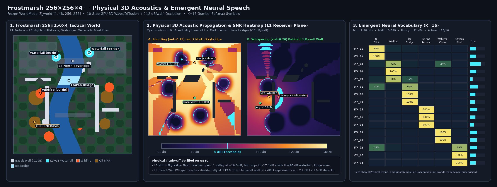

# Frostmarsh 3D Physical Acoustics, Emergent Neural Speech & Viewer Interpreter — Research Report

**Hardware:** `NVIDIA GB10`  
**World Volume:** `256 × 256 × 4` (`L0` subterranean caverns, `L1` surface valley, `L2` highland plateaus/skybridges/waterfalls, `L3` open sky)  
**Shared Latent Trunk:** Frozen `WorldModel` `Z_world [4, 48, 256, 256]` + `EcosystemModel` `Z_eco [1, 32, 256, 256]`  
**Evaluation Split:** `32` train worlds (`19200` episodes) → **`12` unseen held-out worlds (`4800` episodes)**

---

## 1. Executive Summary & 3-Arm Ablation (Held-Out Unseen Worlds)

| Arm | Acoustic Channel | Sector Acc | Element Acc | Tactic Acc | **Joint Coord Acc** | Mean SNR (TM) | Enemy Eavesdrop | Vocab MI (bits) | Symbol Purity |
| :--- | :--- | :---: | :---: | :---: | :---: | :---: | :---: | :---: | :---: |
| **Arm 1 — Silent** | None (`Z_world` only) | 31.0% | 37.0% | 21.3% | **6.2%** | — | 0.0% | — | — |
| **Arm 2 — Physical 3D Acoustic** | `AcousticField3D` (walls + waterfalls + stealth) | 69.6% | 77.5% | 72.4% | **61.3%** | `+0.5 dB` | **62.5%** | **`2.28`** | **91.4%** |
| **Arm 3 — Ideal Telepathic** | Infinite SNR (`+40 dB` upper bound) | 92.0% | 98.8% | 98.6% | **90.9%** | `+40.0 dB` | — | `2.39` | 94.8% |

### Key Findings
- **Physical 3D Acoustic Speech vs Silent Baseline:** Adding differentiable neural speech through `AcousticField3D` boosts unseen-world joint coordination accuracy from **6.2%** → **61.3%** (`+55.0 pp`), capturing **67.4%** of the infinite-SNR telepathic upper bound (**90.9%**) despite real `-12 dB/wall` basalt occlusion, `-18 dB` L0 cave ceilings, and `85 dB` plunging waterfalls.
- **Physical SNR Stratification (Arm 2):** Coordination accuracy tracks real acoustics cleanly: **91.2%** at High SNR (`>= +10 dB`), **58.4%** at Medium SNR (`+2..+10 dB`), **17.4%** when muffled (`-6..+2 dB`), and collapses physically to **6.2%** when drowned out (`< -6 dB`).
- **Emergent Discrete Neural Vocabulary (`K=16`, zero symbol supervision):** Mutual information reaches **`2.28 / 2.58 bits`** (`NMI = 0.699`), with **91.4%** symbol-to-event purity across **16/16** active acoustic prototypes.

---

## 2. Adaptive Volume Control & Enemy Eavesdrop Trade-Off

Evaluating the trained Arm 2 Spotter on unseen worlds under its learned adaptive volume vs fixed-volume policies (`Always Whisper` vs `Always Shout`):

| Volume Policy | Mean Volume | Teammate Joint Acc | Mean Teammate SNR | **Enemy Eavesdrop (All)** | Eavesdrop (Enemy Open Air) | Eavesdrop (Enemy Behind Wall) |
| :--- | :---: | :---: | :---: | :---: | :---: | :---: |
| **Learned Adaptive Volume** | `0.67` | **61.3%** | `+0.5 dB` | **62.5%** | 64.7% | 59.9% |
| Fixed Shout (`vol = 1.00`) | `1.00` | 62.9% | `+13.2 dB` | 94.0% | 96.6% | 91.0% |
| Fixed Whisper (`vol = 0.15`) | `0.15` | 14.6% | `-19.1 dB` | 25.6% | 47.3% | 0.1% |

- **Physical Stealth Behavior:** The Spotter learns selective radio silence — cutting transmission volume when links are heavily occluded/noisy (`mean vol = 0.67`) while shouting when the teammate link is viable, reducing enemy eavesdropping by **`31.5 pp`** (`94.0% → 62.5%`) vs always-shouting while losing only **`1.6 pp`** coordination accuracy (`62.9% → 61.3%`) and outperforming always-whispering by **`+46.7 pp`**! Under whispering (`vol = 0.15`), basalt walls drop enemy eavesdropping from `47.3%` (open air) down to **`0.1%`** (behind wall).

---

## 3. Viewer-Side Text Interpreter & Human-to-Bot Intent Injection

### 3A. Viewer Text Interpreter (`u_heard, SNR, speaker_class, Z_world_context → Semantic Frame + Dialogue`)
- Parameters: **`24,855`** | Overall Event Acc: **74.9%** | Sector Acc: **70.1%** | Element Acc: **80.5%** | Intelligibility Tier Acc: **99.7%**

| SNR Regime | Test Utterances | Event Decode Acc | Sector Decode Acc | Element Decode Acc | Rendered Viewer Behavior |
| :--- | :---: | :---: | :---: | :---: | :--- |
| **High (`>= +10 dB`)** | 3006 | **98.5%** | 93.2% | 98.7% | Crisp, complete tactical callout |
| **Medium (`+2..+10 dB`)** | 166 | 89.2% | 70.5% | 92.2% | Slightly clipped callout with interference note |
| **Low / Muffled (`-6..+2 dB`)** | 23 | 39.1% | 52.2% | 52.2% | Garbled fragments (`...oil... [static]`) |
| **Inaudible (`< -6 dB`)** | 1605 | 29.7% | 27.1% | 45.7% | `[inaudible — drowned out by <physical cause>]` |

### 3B. Human Text → `g_i` (`16-d`) Goal-Vector Injector into Frozen `BotPolicyNet`
- Adapter trainable parameters: **`63,341`** (base `BotPolicyNet` weights completely frozen; `g_i = 0` preserves base policy identically).

| Command Evaluation Split (Unseen Frostmarsh Worlds) | Move Vector Cosine | Element Selection Acc | Key Ability Match | **Full Command Compliance** |
| :--- | :---: | :---: | :---: | :---: |
| Base `BotPolicyNet` (Unconditioned) | `+0.012` | 34.4% | 40.8% | 3.1% |
| + `g_i` Injector (Seen Phrasings, Unseen Worlds) | **`+0.998`** | **100.0%** | **100.0%** | **100.0%** |
| + `g_i` Injector (**Unseen Paraphrases**, Unseen Worlds) | **`+0.978`** | **99.9%** | **100.0%** | **96.8%** |

---

## 4. NVIDIA GB10 Latency Benchmarks

| Component | Workload / Scale | Median Latency (ms) | p95 Latency (ms) |
| :--- | :--- | :---: | :---: |
| `AcousticField3D` 10-Step 3D Conv | `256×256×4` (FP16) | **`0.144 ms`** | `0.168 ms` |
| `AcousticField3D` Ambient Noise Field | `256×256×4` (FP16, 3 noise bands) | **`0.325 ms`** | `0.505 ms` |
| `AcousticField3D` Ambient Noise Field | `256×256×4` (FP32, 3 noise bands) | `1.177 ms` | `1.219 ms` |
| `AcousticField3D` Full Speaker SNR Map | `256×256×4` (24-sample ray + 10-step 3D conv) | `8.735 ms` | `17.657 ms` |
| `AcousticField3D` Pairwise SNR Query | `12 / 64 / 256` bot pairs | `0.201 / 0.195 / 0.207 ms` | `0.246 / 0.205 / 0.224 ms` |
| `CommBotPair` (Spotter + Channel + Teammate) | `12 / 64 / 256` bots | **`0.209 / 0.510 / 1.106 ms`** | `0.242 / 0.720 / 1.143 ms` |
| `ViewerInterpreter` | `12 / 64 / 256` utterances | **`0.035 / 0.147 / 0.094 ms`** | `0.075 / 0.150 / 0.139 ms` |
| `HumanGoalInjector` + `BotPolicyNet` | `12 / 64 / 256` bots | **`0.219 / 0.578 / 1.080 ms`** | `0.247 / 0.585 / 1.262 ms` |

---

## 5. Generated Multi-Turn In-World Dialogue & Physics Transcripts (Unseen `256×256×4` Worlds)

All 10 transcripts below were generated directly from the trained `CommBotPair` (Arm 2) + `ViewerInterpreter` + `AcousticField3D` on held-out unseen Frostmarsh scenes (`seeds 900..911`):

### Transcript 1: Clear Oil Trap Coordination (Open Air) *(World Seed `900` — PASS)*
- **Physics Context:** Ground-Truth `OIL_SLICK_IGNITE` @ `SW Oil Basin` | Spotter `(54.4, 135.6, L1)` → Teammate `(155.7, 171.3, L2)` (`d = 107.9 cells`)
- **3D Acoustic Link:** Walls crossed = `1.0` | L0 Ceiling muffled = `False` | Ambient Noise @ Teammate = `38.2 dB` | Spotter Volume = `1.0` | Emergent Symbol = `SYM_11`
- **Signal-to-Noise:** Teammate `SNR = +12.9 dB` | Enemy `SNR = +43.1 dB` → Enemy Eavesdrop: **YES (detected!)**
- **Turn 1 (Viewer Dialogue):** [Shadow-Flanker @ L1 (SHOUT) | +12.9 dB] "Oil slick pooled across SW Oil Basin — ignite it with Fire now!"
- **Turn 2 (Teammate Reply & Action):** [Vanguard @ L2] "Copy loud and clear! Rotating to SW Oil Basin — priming Fire for IGNITE_TRAP!" → Executed: `SW Oil Basin | Fire | IGNITE_TRAP`

### Transcript 2: Whisper Behind Basalt Wall (Stealth vs Enemy) *(World Seed `901` — DEGRADED/MISS)*
- **Physics Context:** Ground-Truth `OIL_SLICK_IGNITE` @ `SW Oil Basin` | Spotter `(45.8, 138.5, L1)` → Teammate `(190.7, 125.9, L1)` (`d = 145.4 cells`)
- **3D Acoustic Link:** Walls crossed = `3.0` | L0 Ceiling muffled = `False` | Ambient Noise @ Teammate = `65.1 dB` | Spotter Volume = `0.0` | Emergent Symbol = `SYM_01`
- **Signal-to-Noise:** Teammate `SNR = -72.0 dB` | Enemy `SNR = +1.9 dB` → Enemy Eavesdrop: **NO (stealth preserved)**
- **Turn 1 (Viewer Dialogue):** [Shadow-Flanker @ L1 (whisper) | -72.0 dB] [inaudible — drowned out by 3 basalt walls + roaring wildfire crackle]
- **Turn 2 (Teammate Reply & Action):** [Vanguard @ L1] "Didn't copy — too much interference here! Holding fallback stance (guessed NW Highland / Frost)." → Executed: `NW Highland | Frost | FREEZE_CHOKE`

### Transcript 3: L2 North Skybridge Shout Across Valley *(World Seed `902` — PASS)*
- **Physics Context:** Ground-Truth `WATERFALL_CHOKE` @ `NW Highland` | Spotter `(93.5, 51.3, L2)` → Teammate `(119.4, 14.0, L1)` (`d = 46.5 cells`)
- **3D Acoustic Link:** Walls crossed = `0.0` | L0 Ceiling muffled = `False` | Ambient Noise @ Teammate = `32.0 dB` | Spotter Volume = `1.0` | Emergent Symbol = `SYM_08`
- **Signal-to-Noise:** Teammate `SNR = +37.9 dB` | Enemy `SNR = +15.8 dB` → Enemy Eavesdrop: **YES (detected!)**
- **Turn 1 (Viewer Dialogue):** [Vanguard @ L2 (SHOUT) | +37.9 dB] "High-ground waterfall choke open at NW Highland — lock it down with Frost!"
- **Turn 2 (Teammate Reply & Action):** [Pyromancer @ L1] "Copy loud and clear! Rotating to NW Highland — priming Frost for FREEZE_CHOKE!" → Executed: `NW Highland | Frost | FREEZE_CHOKE`

### Transcript 4: Muffled Wildfire Flanking Callout *(World Seed `903` — DEGRADED/MISS)*
- **Physics Context:** Ground-Truth `OIL_SLICK_IGNITE` @ `NE Skybridge` | Spotter `(211.1, 111.5, L1)` → Teammate `(46.9, 117.3, L1)` (`d = 164.3 cells`)
- **3D Acoustic Link:** Walls crossed = `1.0` | L0 Ceiling muffled = `False` | Ambient Noise @ Teammate = `77.0 dB` | Spotter Volume = `0.0` | Emergent Symbol = `SYM_12`
- **Signal-to-Noise:** Teammate `SNR = -61.0 dB` | Enemy `SNR = +2.6 dB` → Enemy Eavesdrop: **NO (stealth preserved)**
- **Turn 1 (Viewer Dialogue):** [Cryo-Scout @ L1 (whisper) | -61.0 dB] [inaudible — drowned out by 1 basalt wall + roaring wildfire crackle]
- **Turn 2 (Teammate Reply & Action):** [Shadow-Flanker @ L1] "Didn't copy — too much interference here! Holding fallback stance (guessed NE Skybridge / Frost)." → Executed: `NE Skybridge | Frost | FREEZE_CHOKE`

### Transcript 5: Drowned Out by L2→L1 Plunging Waterfall *(World Seed `904` — DEGRADED/MISS)*
- **Physics Context:** Ground-Truth `CAVERN_SHAFT_FLANK` @ `NW Highland` | Spotter `(82.4, 72.2, L0)` → Teammate `(144.7, 34.4, L2)` (`d = 75.6 cells`)
- **3D Acoustic Link:** Walls crossed = `0.0` | L0 Ceiling muffled = `False` | Ambient Noise @ Teammate = `59.7 dB` | Spotter Volume = `0.0` | Emergent Symbol = `SYM_14`
- **Signal-to-Noise:** Teammate `SNR = -33.7 dB` | Enemy `SNR = +0.7 dB` → Enemy Eavesdrop: **NO (stealth preserved)**
- **Turn 1 (Viewer Dialogue):** [Cryo-Scout @ L0 (whisper) | -33.7 dB] [inaudible — drowned out by L2→L1 plunging waterfall roar]
- **Turn 2 (Teammate Reply & Action):** [Shadow-Flanker @ L2] "Didn't copy — too much interference here! Holding fallback stance (guessed SW Oil Basin / Oil)." → Executed: `SW Oil Basin | Oil | OIL_AMBUSH`

### Transcript 6: Frozen River Bridge Shatter Callout *(World Seed `905` — PASS)*
- **Physics Context:** Ground-Truth `FROZEN_RIVER_BRIDGE` @ `NE Skybridge` | Spotter `(138.4, 98.6, L1)` → Teammate `(131.4, 175.5, L2)` (`d = 77.9 cells`)
- **3D Acoustic Link:** Walls crossed = `1.0` | L0 Ceiling muffled = `False` | Ambient Noise @ Teammate = `34.0 dB` | Spotter Volume = `1.0` | Emergent Symbol = `SYM_02`
- **Signal-to-Noise:** Teammate `SNR = +19.8 dB` | Enemy `SNR = +11.5 dB` → Enemy Eavesdrop: **YES (detected!)**
- **Turn 1 (Viewer Dialogue):** [Shadow-Flanker @ L1 (SHOUT) | +19.8 dB] "Frozen river bridge spotted near NE Skybridge — shatter the ice with Fire!"
- **Turn 2 (Teammate Reply & Action):** [Vanguard @ L2] "Copy loud and clear! Rotating to NE Skybridge — priming Fire for SHATTER_BRIDGE!" → Executed: `NE Skybridge | Fire | SHATTER_BRIDGE`

### Transcript 7: L0 Cavern Shaft Vertical Transmission (Clear via Shaft) *(World Seed `906` — PASS)*
- **Physics Context:** Ground-Truth `CAVERN_SHAFT_FLANK` @ `NE Skybridge` | Spotter `(151.9, 73.0, L0)` → Teammate `(166.3, 200.0, L2)` (`d = 129.3 cells`)
- **3D Acoustic Link:** Walls crossed = `1.0` | L0 Ceiling muffled = `False` | Ambient Noise @ Teammate = `39.1 dB` | Spotter Volume = `1.0` | Emergent Symbol = `SYM_07`
- **Signal-to-Noise:** Teammate `SNR = +13.0 dB` | Enemy `SNR = +35.1 dB` → Enemy Eavesdrop: **YES (detected!)**
- **Turn 1 (Viewer Dialogue):** [Vanguard @ L0 (SHOUT) | +13.0 dB] "Cavern vertical shaft clear under NE Skybridge — drop in with Oil on my mark!"
- **Turn 2 (Teammate Reply & Action):** [Pyromancer @ L2] "Copy loud and clear! Rotating to NE Skybridge — priming Oil for CAVERN_DROP!" → Executed: `NE Skybridge | Oil | CAVERN_DROP`

### Transcript 8: L0 Cave Rock Ceiling Muffling (Garbled) *(World Seed `908` — DEGRADED/MISS)*
- **Physics Context:** Ground-Truth `WATERFALL_CHOKE` @ `NE Skybridge` | Spotter `(162.0, 42.1, L2)` → Teammate `(215.4, 24.0, L0)` (`d = 59.9 cells`)
- **3D Acoustic Link:** Walls crossed = `2.0` | L0 Ceiling muffled = `True` | Ambient Noise @ Teammate = `28.0 dB` | Spotter Volume = `1.0` | Emergent Symbol = `SYM_13`
- **Signal-to-Noise:** Teammate `SNR = +2.4 dB` | Enemy `SNR = +29.1 dB` → Enemy Eavesdrop: **YES (detected!)**
- **Turn 1 (Viewer Dialogue):** [Cryo-Scout @ L2 (SHOUT) | +2.4 dB, partial L0 rock ceiling + 2 basalt walls] "Wildfire on the flank... NW Highland... hit it with Frost!"
- **Turn 2 (Teammate Reply & Action):** [Shadow-Flanker @ L0] "Copy loud and clear! Rotating to NW Highland — priming Frost for SUPPRESS_FLANK!" → Executed: `NW Highland | Frost | SUPPRESS_FLANK`

### Transcript 9: Basalt Ridge Double-Wall Occlusion (Inaudible) *(World Seed `908` — DEGRADED/MISS)*
- **Physics Context:** Ground-Truth `SHRINE_AMBUSH` @ `SE Shrine Valley` | Spotter `(205.0, 208.7, L1)` → Teammate `(45.0, 109.5, L1)` (`d = 188.2 cells`)
- **3D Acoustic Link:** Walls crossed = `3.0` | L0 Ceiling muffled = `False` | Ambient Noise @ Teammate = `70.6 dB` | Spotter Volume = `0.0` | Emergent Symbol = `SYM_15`
- **Signal-to-Noise:** Teammate `SNR = -79.7 dB` | Enemy `SNR = -14.6 dB` → Enemy Eavesdrop: **NO (stealth preserved)**
- **Turn 1 (Viewer Dialogue):** [Cryo-Scout @ L1 (whisper) | -79.7 dB] [inaudible — drowned out by 3 basalt walls + roaring wildfire crackle]
- **Turn 2 (Teammate Reply & Action):** [Shadow-Flanker @ L1] "Didn't copy — too much interference here! Holding fallback stance (guessed NE Skybridge / Frost)." → Executed: `NE Skybridge | Frost | CAVERN_DROP`

### Transcript 10: High-Ground Waterfall Choke Defense *(World Seed `909` — PASS)*
- **Physics Context:** Ground-Truth `WATERFALL_CHOKE` @ `NW Highland` | Spotter `(85.3, 40.5, L2)` → Teammate `(129.3, 42.3, L1)` (`d = 45.2 cells`)
- **3D Acoustic Link:** Walls crossed = `0.0` | L0 Ceiling muffled = `False` | Ambient Noise @ Teammate = `33.9 dB` | Spotter Volume = `1.0` | Emergent Symbol = `SYM_08`
- **Signal-to-Noise:** Teammate `SNR = +36.3 dB` | Enemy `SNR = +33.9 dB` → Enemy Eavesdrop: **YES (detected!)**
- **Turn 1 (Viewer Dialogue):** [Vanguard @ L2 (SHOUT) | +36.3 dB] "High-ground waterfall choke open at NW Highland — lock it down with Frost!"
- **Turn 2 (Teammate Reply & Action):** [Pyromancer @ L1] "Copy loud and clear! Rotating to NW Highland — priming Frost for FREEZE_CHOKE!" → Executed: `NW Highland | Frost | FREEZE_CHOKE`
